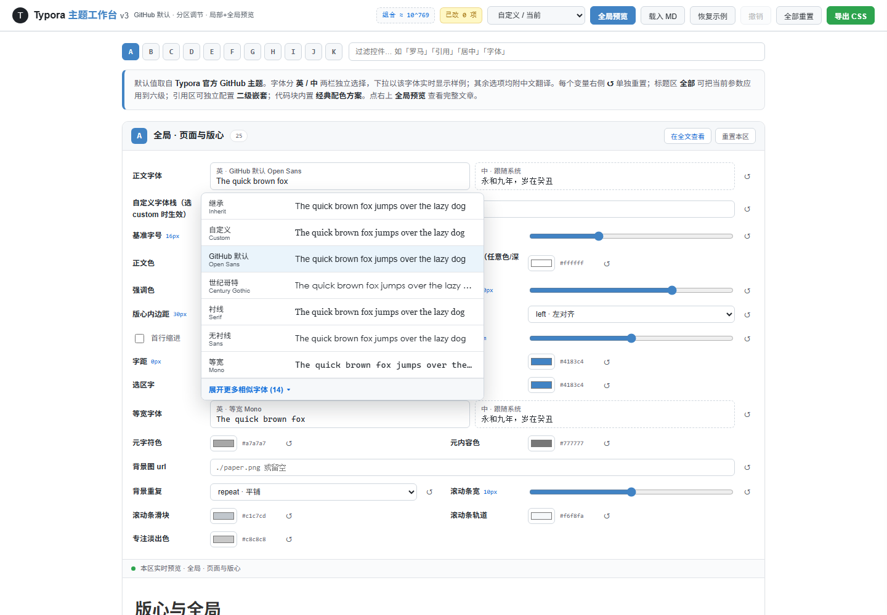
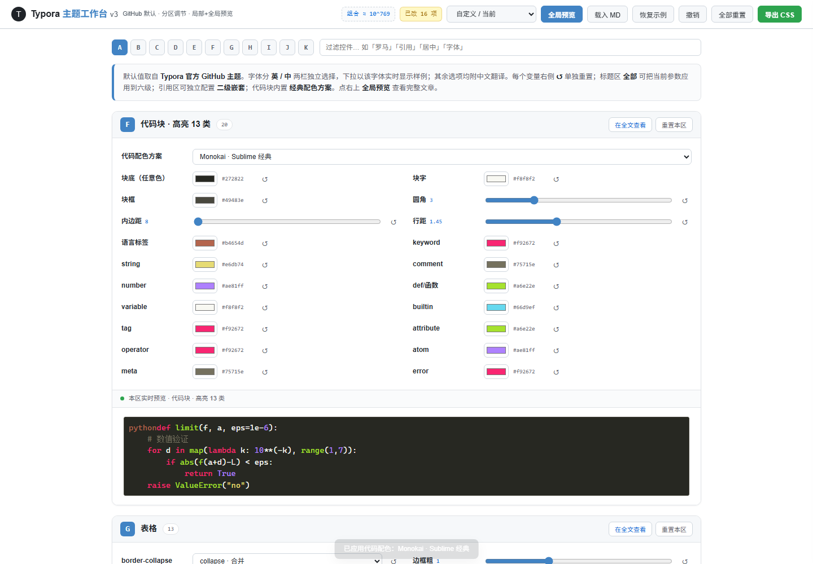
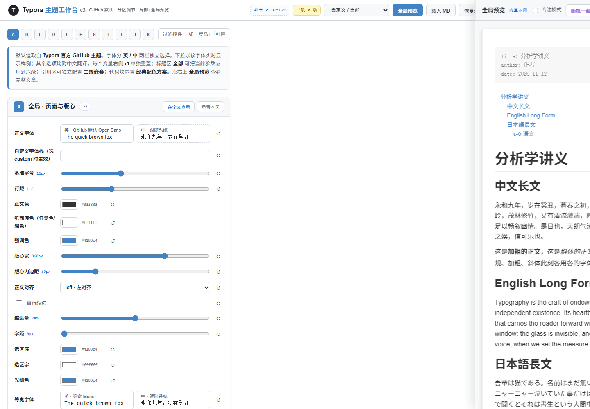
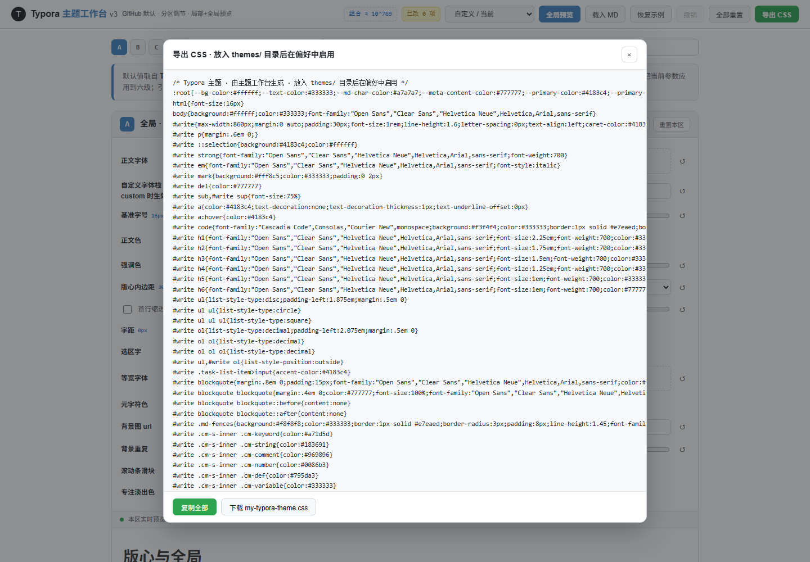

# Typora 主题工作台 · Typora Theme Studio

一个**单文件、零依赖**的 Typora 主题可视化编辑器。在浏览器里拖动滑杆、点选颜色与字体，实时预览效果，最后一键导出可直接放进 Typora 的 `themes/` 目录的 CSS 文件。

-  在线使用：**<https://nishicouqie.github.io/typora-theme-studio/>**
- 💾 离线使用：下载 [`index.html`](index.html) 双击用浏览器打开即可，无需安装任何东西。
- 🎯 默认值完全对齐 **Typora 官方 GitHub 主题**，界面为白色工作台风格。

> 所有计算与预览都在你的浏览器本地完成，**不上传任何数据**；草稿自动保存在浏览器 localStorage。

---

## 截图

| 工作台总览 | 字体下拉（中英分离 · 分组折叠） |
| --- | --- |
|  |  |

| 代码块经典配色（Monokai） | 全局文章预览抽屉 |
| --- | --- |
|  |  |

| 导出 CSS | |
| --- | --- |
|  | |

---

## 功能一览

- **254 个可调参数**，覆盖 Typora 主题几乎全部可定制面：版心 / 行内 / 六级标题 / 列表 / 引用 / 代码块 / 表格 / 分割线 / 图·目录·脚注·YAML·公式 / UI 变量 / 打印导出。
  仅离散选项的理论组合就超过 **10¹²⁵** 种；算上连续颜色更达 **10⁷⁶⁸** 种——理论上可以排列出近乎无限的主题。
- **分区实时预览 + 全局文章抽屉**：每个分区下方有该环节的局部预览；点「全局预览」在右侧抽屉查看整篇中 / 英 / 日长文示例，也可载入自己的 `.md`。
- **字体中英分离**：每个字体槽位拆成「英 / 中」两个独立选择器，组合成 CSS font-stack；下拉选项用该字体实时渲染样例（英文用实词 pangram、中文用古典短句），差异明显的字体置顶、相似字体收进「展开更多」。内置 Century Gothic 等英文字体与宋 / 楷 / 仿宋 / 黑等中文字体。
- **六级标题独立配置**：h1–h6 各自字体 / 字号 / 字重 / 颜色 / 边框 / 前缀 / 编号，支持「应用到全部六级」与自动编号（多种编号风格）。
- **引用一级 / 二级独立**：嵌套引用可单独设置形态（左竖线 / 方框 / 定理框 / 花符 / 底纹 / 无）、颜色、底色、边框、字号、字体。
- **代码块 13 类语法高亮 + 经典配色预设**：Monokai、Dracula、One Dark / Light、Solarized Dark / Light、Nord、Gruvbox、Tomorrow Night、VS Dark、GitHub Light 等，全部取自真实流行配色方案（见下方出处）。
- **整体预设**：GitHub 默认、Newsprint（官方报纸）、Night（官方深色）、Vue（官方文档绿）、Pixyll（官方衬线）。
- **人性化细节**：每个变量旁 ↺ 单独重置、分区重置、全部重置；撤销 / 重做（Ctrl+Z）；浏览器草稿自动保存与恢复；「随机一套」灵感配色；专注模式；导出 CSS 一键复制 / 下载。

## 使用方法

1. 打开在线地址或本地 `index.html`。
2. 用顶部 A–K 标签或过滤框定位分区，拖动 / 点选调整参数，下方局部预览与右侧全局预览实时更新。
3. 满意后点右上「导出 CSS」，复制内容或下载 `.css` 文件。
4. 把文件放入 Typora 主题目录（`文件 → 偏好设置 → 外观 → 打开主题文件夹`），重启 Typora 并在主题列表中选择即可。

## 参数分区

| 区 | 内容 |
| --- | --- |
| A | 全局 · 页面与版心（字体 / 字号 / 行距 / 颜色 / 版心 / 选区 / 滚动条 / 背景） |
| B | 行内 · 粗 / 斜 / 高亮 / 链接 / 行内代码 / 上下标 |
| C | 标题 · 六级独立 + 自动编号 |
| D | 列表 · 逐级符号 × 编号系统 / 任务框 |
| E | 引用 · 一级 / 二级独立配置 |
| F | 代码块 · 13 类高亮 + 经典配色预设 |
| G | 表格 · 边框 / 表头 / 斑马纹 / 三线表 |
| H | 分割线 · 线型 / 花符 |
| I | 图 · 目录 · 脚注 · YAML · 公式 |
| J | UI · `:root` 变量与源码模式 |
| K | 打印 · 导出 PDF（纸张 / 页边距 / 分页 / 孤行） |

## 配色与预设出处

代码配色与整体预设均取自真实、流行的开源方案，非原创：

- 官方主题：[typora/typora-default-themes](https://github.com/typora/typora-default-themes)（GitHub / Newsprint / Night / Pixyll）、[blinkfox/typora-vue-theme](https://github.com/blinkfox/typora-vue-theme)（Vue）
- Monokai：[textmate/monokai.tmbundle](https://github.com/textmate/monokai.tmbundle)
- Dracula：[dracula/visual-studio-code](https://github.com/dracula/visual-studio-code)
- One Dark / Light：[atom/one-dark-syntax](https://github.com/atom/one-dark-syntax)
- Solarized：[altercation/solarized](https://github.com/altercation/solarized)
- Nord：[nordtheme/nord](https://github.com/nordtheme/nord)
- Gruvbox：[morhetz/gruvbox](https://github.com/morhetz/gruvbox)
- Tomorrow Night：[chriskempson/tomorrow-theme](https://github.com/chriskempson/tomorrow-theme)
- VS Dark：[microsoft/vscode](https://github.com/microsoft/vscode)

## 技术说明

- 纯 HTML + CSS + 原生 JS，单文件 `index.html`，无构建、无外部依赖、无网络请求。
- 预览与导出共用同一套 `buildCSS()`，保证「所见即所得」；导出作用域为 `#write` / `:root`，与 Typora 选择器一致。
- 草稿存于 localStorage（键 `txr-studio-v2-draft`），撤销历史为内存快照。

## License

MIT © nishicouqie
